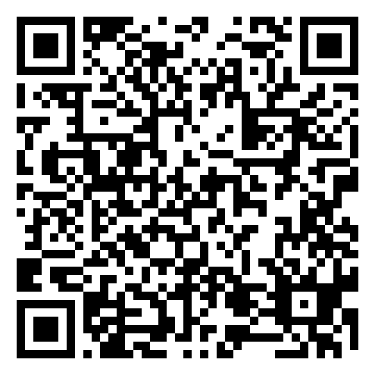
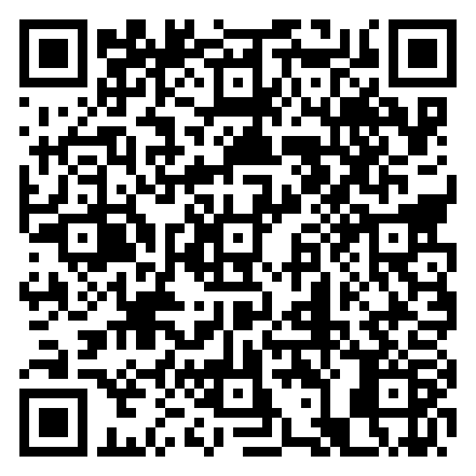

# Zoro Triage · 사진+글 119 신고 1차 분류 에이전트

Trillion Labs AI Agent Hackathon 2026 · Track 1 (Zoro-1 Arena) · Two Drone · 발표 3번

재난 때 119에 사진과 문자 신고가 한꺼번에 몰리면, 접수요원은 하나씩 읽고 누가 먼저인지 정해야 한다. Zoro Triage는 신고 글과 사진에서 **사실(위험한 사람, 진행 여부, 사진 속 피해)** 을 Zoro-1로 판단하고, **운영 규칙**으로 최우선·긴급·일반·비긴급을 매기고, 판단이 애매하면 **사람 확인 필요**를 붙여 접수요원이 최종 결정하게 한다. 접수요원의 수정은 학습 라벨로 쌓인다.

> 훈련용 데모다. 사진+글 분류는 CrisisMMD 실제 재난 사진과 합성 신고 글로 평가했고, 실제 119 접수 현장에 연결되지 않는다.

## 심사위원용: 바로 써 보기 · 실행 로그

**공개 데모** (심사 기간 운영, 심사 전용 키 포함)

| 신고하기 (휴대폰) | 상황판 보기 |
|:---:|:---:|
|  |  |
| [신고 화면 열기](https://reservation-contracting-barrel-invisible.trycloudflare.com/#token=L5JuUkxAdAo3qT17vqjoVkntUO2RTEfu) | [상황판 열기](https://reservation-contracting-barrel-invisible.trycloudflare.com/board#token=aDyibVUV6ALgGzHVx2rvA7xc5TiHPTrG) |

1. **신고하기**에서 사진 한 장(촬영, 앨범, 또는 화면의 예시 이미지)과 상황 한 줄을 보낸다.
2. **상황판**에 카드가 바로 뜨고, 보통 1초 안팎으로 등급·근거·확률이 채워진다.
3. 상황판에서 `훈련 예시 접수`(최우선·불일치·모의 장애 등), `제보 100건 투입`(폭주), `우선순위 규칙 → 규칙 추가`(예: `고립된 고령자·어린이는 최우선`), `모의 장애`, 카드의 `등급 선택`(사람 검수)을 직접 눌러 볼 수 있다.

공개 주소는 Cloudflare 임시 터널이다. 서버가 재시작되면 주소가 바뀔 수 있으며, 그때는 이 README의 링크를 갱신한다. 심사용 키는 심사 종료 후 폐기한다.

**실행 로그** ([`logs/`](logs/)): 현재 정책(`person-choice-v1-damage-choice-v1-review-v2`)으로 실제 Zoro-1 서버에 요청한 기록이다. 한 줄이 한 판정이며 입력(글·사진 경로), 질문별 확률, 등급, 근거, 지연시간이 들어 있다.

| 파일 | 시나리오 | 결과 |
|---|---|---|
| [`scenario-top.jsonl`](logs/scenario-top.jsonl) | 지진 + 의식 없는 사람 | 최우선 (생명 위협 0.99) |
| [`scenario-mismatch.jsonl`](logs/scenario-mismatch.jsonl) | 태풍이라는 글 + 화재 사진 | 최우선 + 사람 확인 필요 (불일치 감지) |
| [`scenario-outage.jsonl`](logs/scenario-outage.jsonl) | 모의 장애 중 신고 | 키워드 폴백(최우선·확인 필요) → 복구 후 Zoro 자동 재판정 |
| [`scenario-past_hazard.jsonl`](logs/scenario-past_hazard.jsonl), [`scenario-rule.jsonl`](logs/scenario-rule.jsonl) | 지난 사건 + 사진 속 위험, 운영 규칙 추가 | 긴급 + 확인 필요 / 규칙 적용으로 최우선 |
| [`decisions.jsonl`](logs/decisions.jsonl), [`proof.json`](logs/proof.json) | 합성 신고 100건 폭주와 전체 점검 | 100건 33.5초, 폴백 0건, 규칙 추가 시 6건 1.4초 재정렬, 전 항목 통과 |

발표 영상(무음 3편)은 발표 슬라이드에 들어 있다. 실제 iPhone 17로 촬영했고, 화면의 시간 수치는 촬영 당시 상황판 기록이다.

## 결과 요약

모든 Zoro 수치는 **학습 라벨 0건**이다.

**사진+글 신고 긴급도** (CrisisMMD 사진 + 합성 신고 글, 사진·글 재난 종류가 일치하는 303건, 4단계)

| 모델 | 학습 라벨 | 깔끔한 글 | 오타·사투리 글 |
|---|---:|---:|---:|
| **Zoro-1** | 0건 | **71.6%** | **71.9%** |
| KcELECTRA+CLIP+규칙 | 50건 | 67.3% | 65.0% |
| KcELECTRA+CLIP+규칙 | 200건 | 73.9% | 68.0% |
| KcELECTRA+CLIP+규칙 | 1,500건 | 77.9% | 78.2% |

- **범용 VLM 비교.** 같은 질문 분해 방식에서 Zoro 62.4%, Qwen2.5-VL-7B 33.7%였다. 건당 중앙값은 291 ms 대 1,213 ms였고, Qwen은 303건 중 56건이 응답 형식 오류로 판정할 수 없었다(56건을 모두 정답으로 쳐도 52.1%). 이 비교는 질문 개선 전 버전이며, 튜닝한 Qwen의 성능까지 뜻하지는 않는다. [7절](bench/BENCHMARK_LOG.md#7-qwen-분해형을-추가한-동일-방식-비교-2026-11-19)
- **오타·사투리 글.** 합성 신고 400건의 사진과 정답을 고정하고 글만 다시 썼다. Zoro는 그대로였고 라벨 200건 이하 전용 파이프라인은 떨어졌다. [18절](bench/BENCHMARK_LOG.md#18-zoro-쪽-신고-글-분포-이동과-추론-모드-재판단-2026-11-20-claude-세션) · [비교 모델](bench/report119/results/noisy-shift/)

**실제 119 신고 통화 전사** (AI Hub, 사람 라벨, 900건, 글만)

| 과제 | Zoro 0건 | TF-IDF 1,000건 | 10,000건 | 127,178건 |
|---|---:|---:|---:|---:|
| 구급 여부 | **94.7%** | 91.1% | 95.1% | 95.7% |
| 대분류 4종 | **89.4%** | 84.8% | 91.1% | 93.0% |
| 긴급도 상·중·하 | **48.7%** | 49.0% | 51.9% | 55.2% |

심정지 통화 16건 중 15건을 긴급도 '상'으로 판정했다. AI Hub 원자료는 재배포가 금지돼 저장소에 넣지 않았다. [19절](bench/BENCHMARK_LOG.md#19-실제-119-신고-통화-전사-평가-ai-hub-2026-11-20-claude-세션)

**처음 보는 재난 사진** (CrisisMMD, 평가 설계에 쓰지 않은 193장, 심각 피해 여부)

Zoro 77.2%, 사진 라벨 2,468장으로 학습한 CLIP 분류기 80.8~81.3%. [평가셋](bench/claude_eval/severity_holdout.py) · [Zoro 채점](evidence/damage-review/image-severity.json)

**한계**
- 흐린 사진에서는 학습한 모델이 더 강하다. 심각 피해 Zoro 65% 대 KcELECTRA+CLIP 73%. [22절](bench/BENCHMARK_LOG.md)
- 생명 위협을 놓치지 않도록 기준을 낮게 잡아, 폭주 100건에서 최우선을 정답(32건)보다 많이(39건) 매긴다.
- 라벨이 수천 건 쌓이면 전용 파이프라인이 앞선다. 그래서 접수요원 수정을 라벨로 저장한다.

## 동작 방식

- 신고 한 건에 Zoro-1 `POST /v1/systemone` 요청 두 번을 병렬로 보낸다. 글 요청은 인명 상태·진행 여부·주장하는 재난 종류, 사진 요청은 피해 정도(3단계)·현장 사진 여부·보이는 재난 종류·진행 중인 위험을 묻는다.
- 정책: 생명 위협, 또는 고립 + 사진 속 진행 위험이면 최우선. 고립·경상·진행 위험·심각한 피해는 긴급. 지난 사건은 비긴급(사진에 위험이 보이면 긴급 + 확인 필요). 운영자가 추가한 조건에 맞으면 최우선.
- **사람 확인 필요**: 글과 사진의 재난 종류가 다를 때(화재 대 비화재), 현장 사진이 아닐 때, 확률이 0.35~0.65이고 그 판단 하나로 등급이 바뀔 때, 폴백일 때.
- **폴백**: 2초 안에 응답이 없으면 글 키워드로 임시 분류하고, 5초 뒤 같은 신고를 Zoro로 다시 판정한다.
- 모든 판정과 사람 수정은 SQLite와 `DEMO_HOME/logs/*.jsonl`에 남는다.

## 직접 실행

L40S(AWS g6e, Ubuntu 22.04, CUDA 13.2) 기준이다. 모델 가중치·사진·키는 저장소에 없다.

1. `bash server/setup_instance.sh`: venv, Zoro-1 서빙 스택(고정 커밋 + 패치), systemd `zoro` 유닛
2. `trillionlabs/Zoro-1` 약관 동의 후 `hf download trillionlabs/Zoro-1`, `sudo systemctl enable --now zoro`
3. `python fixtures/fetch_images.py /ephemeral/crisis_bench/crisismmd` (예시·폭주용 사진만)
4. `CRISIS_ROOT=/ephemeral/crisis_bench/crisismmd ZORO_URL=http://127.0.0.1:30001 DEMO_WORKERS=4 python server.py`
5. 신고 화면 `/#token=<report>`, 상황판 `/board#token=<admin>` (키는 `DEMO_HOME/access.json`)

검사: `python -m unittest discover -s tests` (45개), 실서버 통합 점검 `proof.py`.

## 저장소 구성

- 루트: 데모 앱(`server.py`, `store.py`, `decision.py`, `static/`), 테스트(`tests/`)
- `logs/`: 심사용 실행 로그 · `evidence/`: 이전 버전 실행 기록과 촬영 자료
- `bench/`: 벤치마크 기록 [`BENCHMARK_LOG.md`](bench/BENCHMARK_LOG.md)과 스크립트·결과
- `server/`: Zoro-1 서빙 설정, 전처리 병렬화 패치, 설치 스크립트
- `docs/`: 도입 근거 조사, Zoro 서버 안내, 심사용 QR

## 라이선스와 데이터

코드는 [Apache-2.0](LICENSE). 사진은 [QCRI CrisisMMD v2](https://huggingface.co/datasets/QCRI/CrisisMMD) ([CC BY-NC-SA 4.0](https://creativecommons.org/licenses/by-nc-sa/4.0/))이며 원본은 저장소에 없다. 신고 글은 합성 데이터다. AI Hub 119 신고 전사 데이터는 수치만 기록했다.
